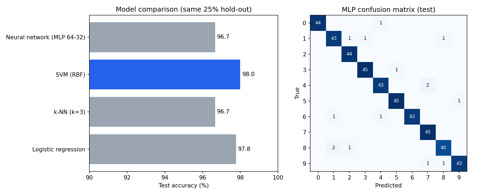
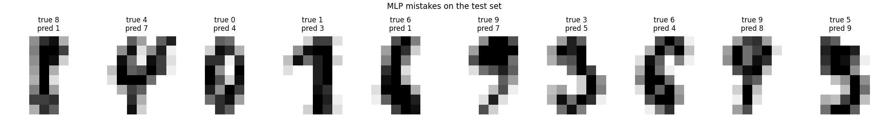
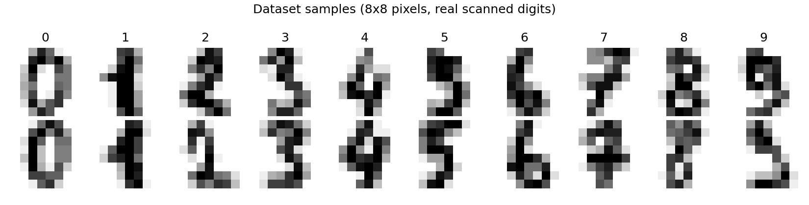

# Handwritten Digit Recognition: Neural Network vs Classic Models

Compares a small neural network (MLP) with logistic regression, k-NN and an RBF SVM on handwritten digits, using the same split and 5-fold cross-validation.

**Data:** scikit-learn's bundled digits set: 1,797 real scanned digits, 8x8 pixels, 10 classes (UCI). 75% train / 25% test (450 images), stratified, seed 42.

## Results (computed by `digit_recognition.py`, see `run_output.txt`)

| Model | 5-fold CV accuracy (train) | Test accuracy |
|---|---|---|
| Logistic regression | 96.6% +- 1.0 | 97.8% |
| k-NN (k=3) | 97.3% +- 0.4 | 96.7% |
| **SVM (RBF, C=10)** | **97.9% +- 0.6** | **98.0%** |
| Neural network (MLP 64-32) | 97.4% +- 0.9 | 96.7% |

- The SVM is best on both measures. The MLP is 15 errors out of 450 on the test set, scattered across classes. Digits 1 and 8 are the weakest (F1 0.935 and 0.941).
- Differences between models are about 1 to 2 points on 450 test images, so the ranking is not strongly separated. CV standard deviations overlap.
- Scaling is fit inside each pipeline, so there is no leakage from the test set.





## Run
```
pip install -r requirements.txt
python digit_recognition.py
```
Outputs `results.json`, `images/*.png`.

## Limits
Small low-resolution images; a convolutional network on MNIST would be the next step. Hyperparameters were set by hand, not searched.
